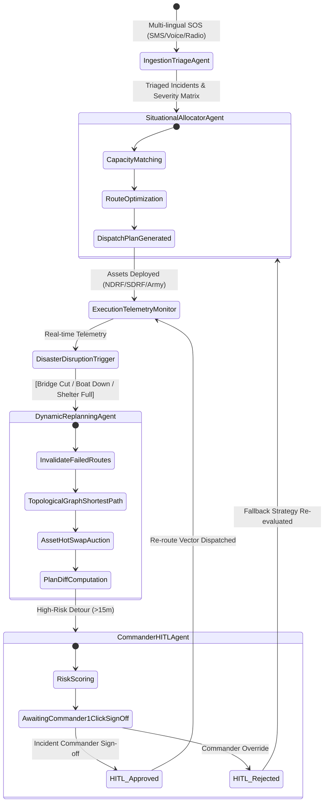

# AegisRelief AI — Architecture & StateGraph Specification

## 1. System Overview
AegisRelief AI is an autonomous, self-healing multi-agent disaster resource coordination system engineered for high-consequence flood disasters (SDG 11 & SDG 13).

## 2. Multi-Agent StateGraph Specification

## 3. Data Flow & Latency Budget
- **Ingestion & Triage:** < 12ms (Heuristic Fast Path) / < 850ms (Gemini 2.5 Flash Multilingual API)
- **Situational Allocation:** < 18ms (Multi-Objective Constraint Solver)
- **Disruption Detection & Edge Invalidation:** < 5ms
- **Topological Shortest Path Replanning:** < 15ms
- **Commander Gate Presentation:** Immediate async render with full PlanDiff audit trail.
